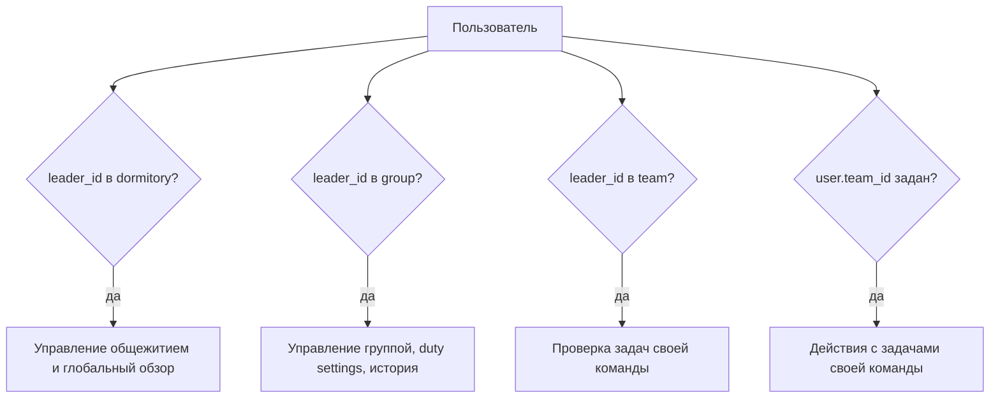

# Авторизация и полномочия

## Пароли и вход

Единственный runtime-алгоритм — Argon2id: версия 19, память 19 MiB (`m=19456` KiB), 2 итерации, parallelism 1, случайная соль 16 байт и результат 32 байта. PHC-подобная строка содержит параметры, соль и результат; помещается в `password_hash VARCHAR(255)`. Проверка принимает только эти параметры и размеры, сравнение результата выполняется за постоянное время.

`AuthenticateResident` обрезает внешние пробелы, ограничивает логин 255 байтами и пароль 4096 байтами. Неизвестный логин и неверный пароль дают одинаковый `401` с `{"error":"неверный логин или пароль"}`. Для неизвестного пользователя или некорректного сохранённого хеша выполняется dummy Argon2id. При заведомо невалидном формате входа отказ происходит раньше вычисления хеша.

CRUD жителя требует логин `[a-z0-9._-]+` длиной до 255 символов; новый пароль — минимум 6 символов, только латинские буквы и цифры. Внешние пробелы удаляются. Пароль обязателен и при `UpdateResident`: передача прежнего значения сохраняет сессии; фактическая смена отзывает их. Bootstrap отдельно требует минимум 8 символов. Это разные точки валидации, а не единая политика сложности.

Production при старте проверяет уникальность активных логинов и корректный Argon2id у всех активных пользователей. Неготовые credentials блокируют запуск. SHA-256 проверяется только одноразовой утилитой [миграции паролей](../operations/deployment.md#первый-переход-на-новую-авторизацию), без fallback и автоматического rehash при login.

## Серверные сессии

- `POST /api/v1/auth/login` проверяет пароль и создаёт новую независимую сессию.
- Токен `v2.<base64url>` содержит 32 случайных байта из `crypto/rand` (256 бит). В `auth_session.id` хранится SHA-256 полного токена, а не bearer token.
- Срок — 365 дней от создания, без sliding/idle продления. Сервер хранит `user_id`, `created_at`, `expires_at`, `revoked_at`.
- Сохранение сессии блокирует пользователя и сверяет текущий password hash с проверенным при login. Конкурентная смена пароля или удаление пользователя не позволяет выдать сессию по старым credentials.
- Cookie устанавливается только после успешного сохранения. Неудачный login не меняет прежнюю cookie.
- Все защищённые API используют `ResidentAuthMiddleware`: один запрос с JOIN проверяет существование сессии, отзыв, срок и `user.deleted_at IS NULL`. Контекст этой проверки ограничен 5 секундами.
- `POST /api/v1/auth/logout` идемпотентно отзывает только текущую сессию и очищает cookie; ответ `204`. Некорректная или отсутствующая cookie очищается без обращения к хранилищу. Ошибка БД не выдаётся за успешный отзыв.
- Смена пароля и отзыв всех сессий пользователя выполняются одной транзакцией. Soft delete также транзакционно отзывает сессии; связанные исторические данные сохраняются. Изменение обычных полей не отзывает сессии и не перезаписывает конкурентно обновлённый пароль.
- Сессии разных устройств независимы. Старые stateless-cookie и любой иной формат отклоняются с `401`, автоматической миграции нет.

Невалидная сессия даёт `401` и `{"error":"требуется авторизация"}`. Сбой MySQL — `503`, deadline — `504`, отмена — `503`; временная ошибка не очищает cookie. Обнаружение неактивного пользователя очищает её. Отзыв проверяется на каждом новом запросе; это не означает отмену уже выполняющегося use case.

## Cookie и защита HTTP

Имя — `resident_session`; `HttpOnly`, `Path=/`, host-only (без Domain), `SameSite=Lax`, согласованные `Expires` и `Max-Age`. В production `Secure=true`, в development разрешён HTTP. Установка и очистка используют один набор атрибутов. Режим берётся из `APP_ENV`, не из proxy-заголовков.

`OriginProtection` для всех `/api/` проверяет POST/PUT/PATCH/DELETE, включая login, logout и push subscriptions. Нужен точный нормализованный Origin (схема, hostname, порт); чужой, отсутствующий и `null` отклоняются с `403` до use case. Referer fallback отсутствует. Сессия при этом не очищается.

Production требует `APP_ENV=production`, один HTTPS `AUTH_ORIGIN` и явный `AUTH_TRUSTED_PROXIES` (IP/CIDR через запятую). Полное доверие всем адресам запрещено. Только от доверенного proxy принимается валидный `X-Real-IP`; proxy обязан заменять его адресом клиента. Иначе login в production получает `503`. Произвольный `X-Forwarded-For` не используется. TLS между proxy и Fiber не требуется: Secure-cookie относится к браузерному HTTPS.

Development разрешает ровно `http://localhost:8080`, `https://localhost:5173`, `http://127.0.0.1:8080`, `https://127.0.0.1:5173`, плюс явно заданный `AUTH_ORIGIN`. Произвольные localhost-порты не разрешены. Секрет подписи сессий не используется: `AUTH_SECRET` и legacy-настройки удалены; VAPID-ключи Web Push остаются отдельной конфигурацией.

## Ограничение входа и диагностика

Login limiter хранится в памяти одного backend, защищён mutex и ограничен 10 000 записями:

- IP + нормализованный логин: 5 неудачных попыток за 15 минут;
- IP: token bucket ёмкостью 250, восстановление 250 токенов за 900 секунд (один за 3,6 секунды);
- не более 4 одновременно выполняющихся login-проверок.

Квота резервируется до проверки и возвращается при успехе или инфраструктурной ошибке. Отсутствие слотов не расходует квоту ошибок. `429` содержит `Retry-After`: остаток account-окна, время до токена, 2 секунды для concurrency либо ожидание освобождения ёмкости. Состояние теряется при перезапуске и не разделяется между репликами.

Структурированные события с Request ID: `auth.session_created`, `auth.session_revoked`, `auth.session_rejected`, `auth.csrf_rejected`, `auth.login_rate_limited`. Причины отказа сессии: `missing_cookie`, `malformed_token`, `session_not_found`, `session_revoked`, `session_expired`, `user_inactive`, при выдаче — `credentials_changed`. Причины limiter: `account_source_limit`, `source_rate_limit`, `concurrency_limit`, `limiter_capacity`. Отсутствующая cookie логируется на INFO, другие отклонения — WARN, инфраструктура — ERROR. Cookie, токены, пароли и полные хеши не логируются; наружу подробная причина не передаётся.

## Базовые отношения

Права выводятся из текущих связей, а не из отдельной роли:

- глава общежития: `dormitory.leader_id == currentUser.id`
- глава группы: `group.leader_id == currentUser.id`
- глава команды: `team.leader_id == currentUser.id`
- участник команды: `user.team_id == team.id`

Один пользователь может одновременно быть:

- главой общежития;
- главой группы;
- главой команды;
- обычным участником своей команды.

## Модель прав

## Фактические permission rules

| Действие | Кто может |
| --- | --- |
| Логин в resident app | активный пользователь с валидным Argon2id-паролем |
| Просмотр текущего дежурства своей группы | житель, у которого есть доступ к группе через текущее членство или лидерство |
| Выбор любой группы/общежития | только глава общежития |
| Просмотр истории дежурств группы | только глава этой группы |
| Просмотр деталей старого дежурства | только глава доступной группы |
| Взять/вернуть/завершить задачу | участник команды этого дежурства, пока дежурство активно или пока у прошедшего дежурства есть незакрытые задачи |
| Подтвердить/переоткрыть задачу | текущий участник и глава команды `duty.team_id` в доступном для действий периоде |
| Создать дежурство группы вручную | только глава группы |
| Менять duty settings группы | только глава группы |
| Управлять общежитиями, группами, жителями, территориями, каталогом задач | только глава любого общежития |
| Управлять предупреждениями | глава общежития в пределах всех возглавляемых общежитий; иначе глава группы в пределах своего текущего общежития |
| Управлять складом общежития | глава общежития своего текущего общежития; иначе глава группы своего текущего общежития |

## Особенности resident access model

`resident.Service` сначала строит `residentAccessContext`:

- приоритет принадлежности: текущая команда, затем руководство командой в доступных группах, затем руководство группой;
- глава команды, если `team_id` у него отсутствует, всё равно может быть распознан по `team.leader_id`;
- глава группы без команды имеет доступ к своей группе;
- глава общежития может выбрать любую группу внутри выбранного общежития, а также другой `dormitory_id`.

Frontend лишь показывает поля:

- `can_manage_dormitories`
- `can_manage_penalties`
- `can_manage_warehouse`
- `can_manage_tasks`
- `can_manage_duty_settings`

Источником истины для этих флагов остаётся backend.

## Важные ограничения

- Нет общего RBAC и нет таблицы `role`.
- Права вычисляются по текущим связям, поэтому их изменение сразу влияет на доступ.
- Для истории дежурств используется текущее лидерство группы/команды, а не снапшот полномочий на прошлую дату.
