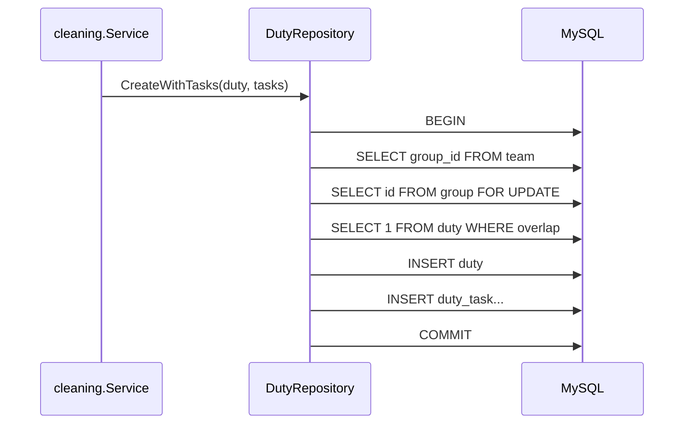

# Дежурства

## Назначение

`Duty` — недельное дежурство одной команды. Оно связывает:

- `group` через `duty.group_id`;
- конкретную дежурную `team`;
- полуоткрытый период `[start_date, end_date)`;
- последовательный номер `sequence_number`;
- список `DutyTask`.

Основная реализация: `pkg/core/domain/duty`, `pkg/core/usecase/cleaning`, `pkg/core/usecase/resident`, `pkg/infrastructure/mysql/repository/duty.go`.

## Основные сущности

- `Duty`
- `DutyTask`
- `DutyTaskOverride`

## Инварианты

- внутри одной группы `sequence_number` уникален;
- внутри одного `duty` задача каталога может появиться только один раз;
- периоды двух `duty` одной группы не должны пересекаться;
- период трактуется как `[start, end)`;
- активность определяется по локальному времени приложения;
- история не снапшотит связанные `task/team/user`.

## Timezone

- scheduler и use-case используют `TZ` из env;
- HTTP helper `parseDutyPeriod` нормализует даты к `09:00` в этой timezone;
- типичный runtime timezone проекта — `Europe/Moscow`.

## `sequence_number`

`sequence_number` — это порядковый номер дежурства внутри группы.

Он нужен для:

- явного порядка истории;
- recurrence задач по sequence;
- устойчивой ротации и дедупликации создания дежурств.

Начальное значение для группы — `1`, далее номер увеличивается на 1 от `FindLatestByGroupID`.

## Формирование дежурства

### Автоматический weekly flow

`StartNewWeek`:

1. читает все группы;
2. подбирает команду для каждой группы;
3. создаёт `Duty` на период `now .. now+7d`;
4. распределяет территории и задачи;
5. сохраняет `duty` и `duty_task`;
6. очищает применённые overrides;
7. публикует `week.started`.

### Ручной flow

`StartNewDutyForGroup`:

- доступен только главе группы;
- принимает `start_date` и `end_date`;
- создаёт дежурство только для одной группы;
- использует тот же алгоритм ротации, recurrence и override.

## Выбор команды

Актуальный механизм опирается на `team.rotation_position`, а не на удалённый `group.next_duty_team`.

Алгоритм:

1. загрузить все команды группы;
2. отсортировать по `rotation_position`;
3. если предыдущего дежурства нет, взять первую команду;
4. если предыдущее дежурство есть, найти его `team_id` и выбрать следующую команду по кругу.

Если команда из последнего дежурства больше не входит в ротацию, создание нового дежурства для группы прерывается ошибкой.

## Распределение задач

Алгоритм `distributeTasks`:

1. групповые территории попадают только в duty своей группы;
2. общие территории (`area.group_id IS NULL`) раздаются между duty round-robin;
3. стартовый round-robin индекс = `CountDistinctStartDates() % len(duties)`;
4. по каждой задаче проверяется `TaskDefinition.IsScheduledFor(duty.SequenceNumber())`;
5. если есть `DutyTaskOverride`, он полностью переопределяет обычную recurrence;
6. due-задачи превращаются в `DutyTask`.

## Override-механизм

`duty_task_override` хранит только одноразовое решение для ближайшего включения:

- `include_in_next_duty = true` принудительно включает задачу;
- `false` принудительно исключает её;
- после успешного сохранения нового дежурства override удаляется.

Если сохранение `duty` не удалось, overrides не очищаются.

## Пересечение периодов

Создание `Duty` использует транзакцию и `SELECT ... FOR UPDATE` по строке `group`.

Полуоткрытый интервал означает:

- `future`: `start > now`
- `active`: `start <= now < end`
- `past`: `end <= now`

## Действия с прошедшим дежурством

Прошедшее дежурство не сразу становится read-only.

Фактическое правило:

- если дежурство прошлое, но в нём есть хотя бы одна задача без `verification_date`, команда всё ещё может взаимодействовать с ним;
- как только все задачи проверены, действия блокируются.

Это важно для late completion после формального окончания недели.

## Read-only режим

Resident view становится read-only, когда:

- пользователь не состоит в команде этого дежурства;
- дежурство будущее;
- дежурство прошлое и в нём не осталось незакрытых задач;
- пользователь смотрит history details, а не current-duty экран.

## Прогресс

История и current-duty UI считают:

- `total_cost_sum`
- `taken_cost_sum`
- `total_tasks_count`
- `taken_tasks_count`
- `completed_tasks_count`
- `verified_tasks_count`

Для resident view дополнительно считается:

- `cost_per_resident_goal`
- `my_taken_cost_sum`

Цель по баллам округляется вверх от общей суммы стоимости задач на число участников команды.

## История дежурств

История доступна только главе группы.

Источник — `DutyRepository.FindHistoryByGroupID`, который агрегирует прогресс SQL-запросом и сортирует по:

1. `start_date DESC`
2. `sequence_number DESC`
3. `id DESC`

### Последнее незавершённое прошлое дежурство

Если активной команды нет или она отличается от собственной команды жителя в выбранной группе, проверяется последнее незавершённое прошлое дежурство собственной команды. При наличии оно показывается вместо активного. Если сейчас дежурит собственная команда, её прошлое дежурство не подменяет активное. Незавершённым считается наличие задачи без `verification_date`; выбирается наибольший sequence, затем start_date и ID.

Это позволяет дочистить и дозакрыть задачи старой недели.

## Где реализовано

- домен: `pkg/core/domain/duty/*.go`
- создание и ротация: `pkg/core/usecase/cleaning/distribution.go`
- task actions: `pkg/core/usecase/cleaning/service.go`
- resident projection: `pkg/core/usecase/resident/service.go`
- транзакции и overlap: `pkg/infrastructure/mysql/repository/duty.go`

## Выбор текущего дежурства и загрузка данных

Принадлежность определяется сначала по `user.team_id`, затем по руководству командой в доступных группах, затем по руководству группой. Глава любого общежития может выбирать группу и другое общежитие; это не даёт автоматически прав главы выбранной группы на историю или настройки.

У наблюдателя без своей команды/группы автоматически выбирается первая группа с активным дежурством в отсортированном списке групп; при отсутствии таких — первая группа, пустой список является ошибкой. Глава общежития использует штатный выбор группы, а не этот observer fallback.

Активное дежурство определяется одним поиском по группе: сначала команда по `rotation_position`, `name`, ID; затем её наиболее позднее `start_date`, при равенстве ID по убыванию. Граница начала включена, окончания исключена. Это не глобально самое позднее дежурство среди команд. Для одной операции поиска используется один момент времени.

DORM-108 заменяет перебор команд/групп SQL-запросами на пакетный поиск, не меняя правила выбора. `GetCurrentDuty` и `GetDutyDetails` используют общую загрузку: только нужные неудалённые определения задач, затем их территории; участники команды загружаются пакетом. Имя руководителя переиспользуется из состава либо читается отдельно, без искусственного добавления в `team_members`.

Отсутствующее или удалённое определение, как и отсутствующая территория, исключает соответствующую задачу из resident projection. История агрегируется отдельно и может учитывать стоимость soft-deleted определения. DTO истории и её подробности поэтому не являются неизменным историческим snapshot.

Создание нескольких дежурств не является одной общей транзакцией: каждая группа сохраняется отдельно. Ошибка поздней стадии может оставить ранее записанные дежурства; диагностические события отражают созданные/пропущенные группы и стадию отказа.

## Отличие редактора duty settings

Resident view и task actions используют точный полуоткрытый интервал времени. В duty settings `requireActiveLatestDuty` проверяет последнее по sequence дежурство по локальным календарным датам, включая дату end_date. На границах суток/09:00 понятие активного дежурства редактора и resident API может различаться. Это текущее расхождение реализации; его нельзя трактовать как единое временное правило для всех экранов.
